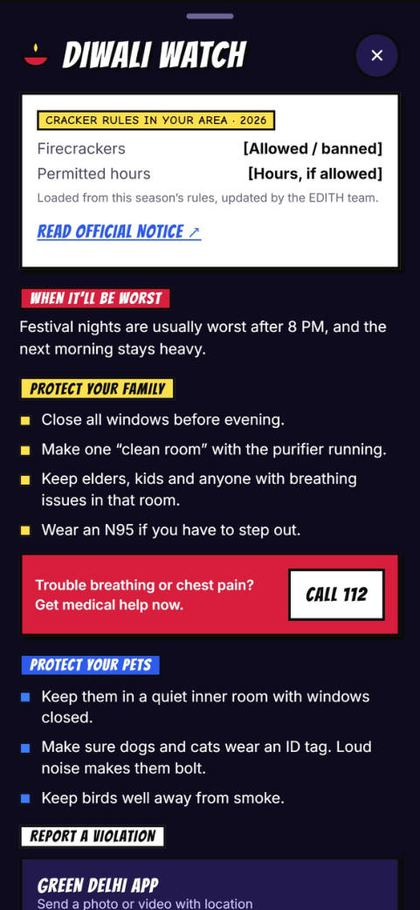

<p align="center">
  
</p>

<h3 align="center">Know your air. Own your share.</h3>

<p align="center">
  <b>Environmental Defence &amp; Impact Tracking Hero</b><br>
  Live air quality and carbon tracking, built around how India actually lives.
</p>

<p align="center">
  <a href="https://edith-navy.vercel.app"><b>Try it live</b></a>
</p>

<p align="center">
  
  
</p>

## The problem

Air pollution takes about **8 years** off a Delhi resident's life, and nearly half of Delhi's pollution comes from local sources ([AQLI 2025, University of Chicago](https://aqli.epic.uchicago.edu/)). People know the air is bad. They just can't do much with what they're told about it.

- **An AQI number isn't an answer.** "AQI 340" won't tell you if your mother can go for her walk, or when today is safest to step out.
- **Carbon calculators weren't made for India.** Foreign units, foreign averages, and advice like "buy an EV" that doesn't fit most lives here.
- **A total changes nothing.** Knowing you emit 2 tonnes a year doesn't tell you which one habit to change first, or what you'd save.
- **Air apps and carbon apps never meet.** One shows what you breathe, the other what you emit, and nothing connects the two.

## What EDITH does

EDITH answers two questions most people never get a straight answer to: is it safe to go out, and what can I actually change?

| Your air | Your impact |
| --- | --- |
| Live AQI on India's own CPCB scale | Your carbon footprint, from a 30-second daily check-in |
| What you breathed today, in cigarettes and "lives" | Kept accurate by your monthly electricity bill |
| The cleanest two hours of your day | The one source that matters most for you |
| Alerts for parents, children and pets | Cuts that fit your life, in kg CO2 and rupees |

## Features

**One sentence before any chart.** Most air apps open with a wall of numbers, graphs and tables. EDITH opens by telling you what to do today, in one line, and keeps the detail a tap away for when you want it.

<table>
  <tr>
    <td colspan="2" align="center" valign="top" width="66%">
      <b>Comic book or calm: you choose</b><br>
      <sub>Fight smog as a superhero in a comic-book city, or keep it clean and minimal. Switch any time.</sub>
    </td>
    <td align="center" valign="top" width="33%">
      <b>Know when to step out</b><br>
      <sub>Go Time finds your cleanest two hours, from an hour-by-hour forecast for your area.</sub>
    </td>
  </tr>
  <tr>
    <td align="center"><br><sub>Hero</sub></td>
    <td align="center"><br><sub>Plain</sub></td>
    <td align="center"><br><sub>Design preview</sub></td>
  </tr>
  <tr>
    <td align="center" valign="top">
      <b>A 30-second check-in</b><br>
      <sub>Already filled in from your routine. Most days you just confirm it.</sub>
    </td>
    <td align="center" valign="top">
      <b>See what really drives your footprint</b><br>
      <sub>Your biggest source, and cuts priced in kg and rupees using your own distance and fuel.</sub>
    </td>
    <td align="center" valign="top">
      <b>A reason to come back tomorrow</b><br>
      <sub>Your city lights up as you show up: streaks, ranks and badges, measured only against your own start.</sub>
    </td>
  </tr>
  <tr>
    <td align="center"><br><sub>Design preview</sub></td>
    <td align="center"><br><sub>Design preview</sub></td>
    <td align="center"><br><sub>Working app, demo progress</sub></td>
  </tr>
  <tr>
    <td align="center" valign="top">
      <b>Looks out for everyone at home</b><br>
      <sub>"Keep Dadi inside till 2." "Walk the dog during Go Time." A warning for each of them, before the air turns.</sub>
    </td>
    <td align="center" valign="top">
      <b>Ask it anything about your air</b><br>
      <sub>"Is it safe for Dadi to go out?" EDITH answers from your forecast, your routine and your family, not generic advice.</sub>
    </td>
    <td align="center" valign="top">
      <b>Ready for Diwali</b><br>
      <sub>This year's cracker rules, the worst hours, how to protect family and pets, and how to report a violation.</sub>
    </td>
  </tr>
  <tr>
    <td align="center"><br><sub>Design preview</sub></td>
    <td align="center"><br><sub>Design preview</sub></td>
    <td align="center"><br><sub>Design preview</sub></td>
  </tr>
</table>

**Built for India, not adapted for it.** CPCB's AQI scale, India's own grid emission factor, Delhi Metro fares, LPG cylinders, autos and two-wheelers, dal and paneer. EDITH never suggests something that doesn't fit your life, so nobody who already rides the Metro gets told to take the Metro.

## How the numbers work

**Footprint = what you did × its emission factor.** Air quality uses CPCB's method on [Open-Meteo](https://open-meteo.com/en/docs/air-quality-api) data.

| | | Source |
| --- | --- | --- |
| Electricity | 0.727 kg CO2 per unit | CEA Baseline Database v20.0 |
| AQI | CPCB National AQI bands | [CPCB, via IES](https://ies.gov.in/arthapedia/concept/national-air-quality-index) |
| Cigarettes | 22 µg/m³ PM2.5 for a day ≈ 1 cigarette | Berkeley Earth |
| Food | About 0.6 kg a day vegetarian, 1 kg non-veg | Pathak et al. 2010 |

These are estimates to help you plan, not measurements or medical advice. Some factors, such as deliveries and flights, are our own working estimates. All of them are labelled in [`lib/factors.ts`](lib/factors.ts).

## Tech stack

<p>
  
  
  
  
  
  
  
  
</p>

## Get started

**Try it now:** [edith-navy.vercel.app](https://edith-navy.vercel.app). Choose **Try without an account** and you're in, with no sign-up.

**Run it yourself** (Node.js 20 or newer):

```bash
git clone https://github.com/ashima19arora/edith.git
cd edith
npm install
npm run dev
```

Then open http://localhost:3000. Guest mode needs no keys. For Google sign-in, copy `.env.example` to `.env.local`, add your Supabase keys, and run [`supabase/migrations/0001_init.sql`](supabase/migrations/0001_init.sql) in the Supabase SQL editor.
