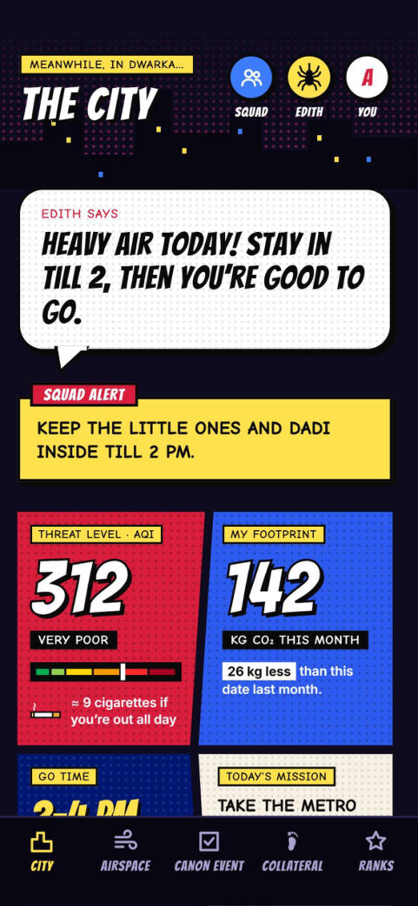
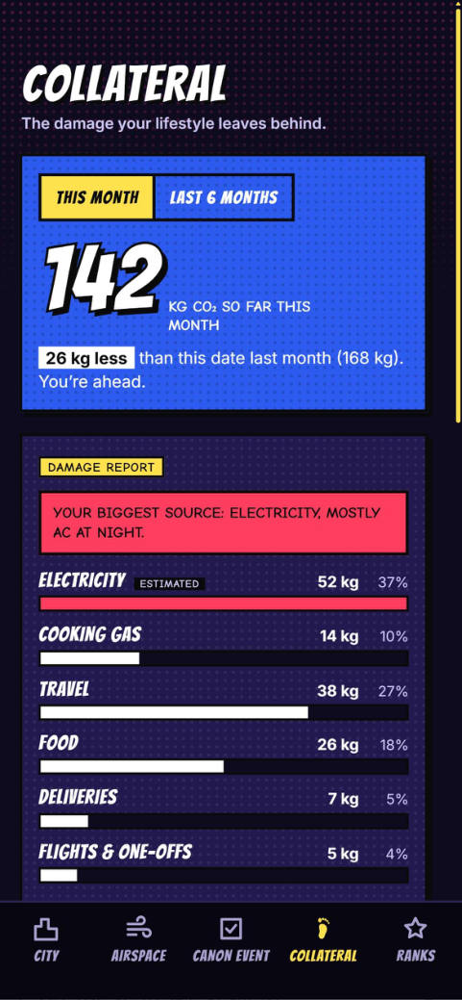
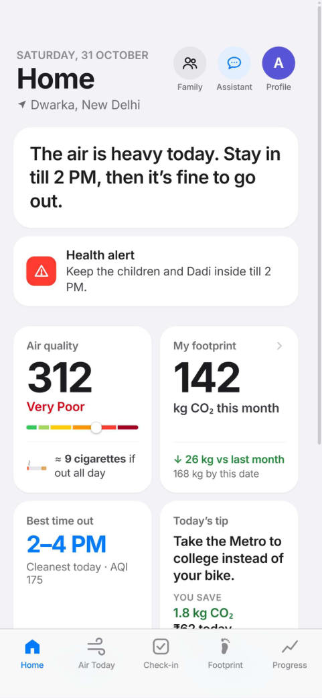
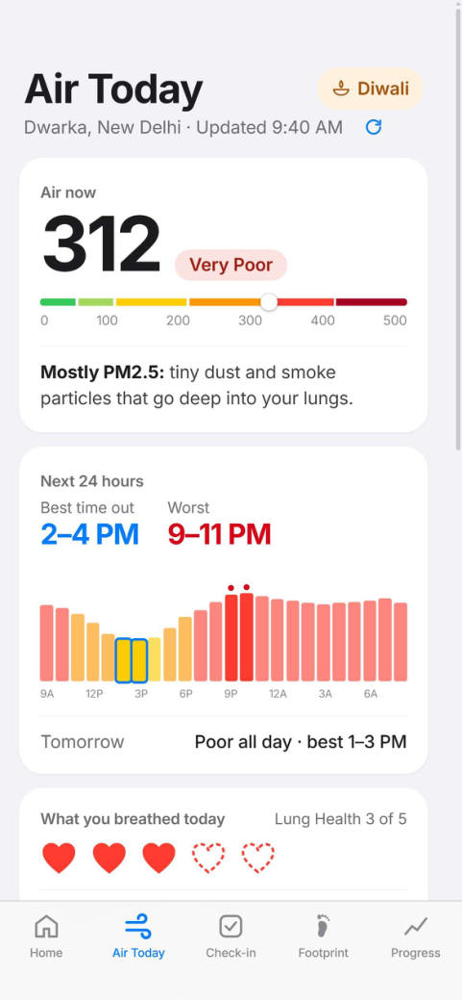
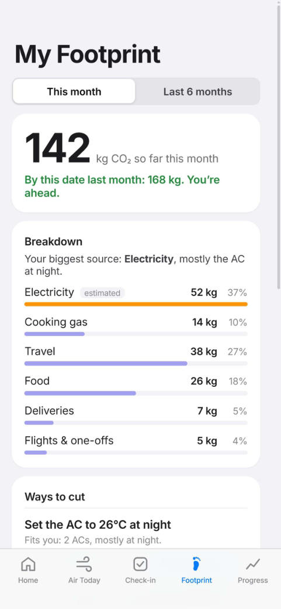

<p align="center">
  
</p>

<p align="center">
  
  
  
</p>

<h3 align="center">Dodge the smog. Shrink your share of it.</h3>

<p align="center">
  <b>Environmental Defence &amp; Impact Tracking Hero</b><br>
  An India-first air quality and carbon footprint companion. Live AQI, a 30-second daily check-in, family and pet alerts, and cuts that fit your life.
</p>

<p align="center">
  <a href="https://edith-navy.vercel.app"><b>Try it live</b></a> 
</p>

## Table of contents

- [The problem](#the-problem)
- [What EDITH does](#what-edith-does)
- [How the numbers work](#how-the-numbers-work)
- [Tech stack](#tech-stack)
- [Run it locally](#run-it-locally)

## The problem

Air pollution takes about **8 years** off a Delhi resident's life, against 3.5 years for the average Indian, and nearly half of Delhi's pollution comes from local sources ([AQLI 2025, University of Chicago](https://aqli.epic.uchicago.edu/)).

Yet the tools people have don't help them act on it:

- **The numbers mean nothing.** "AQI 340" doesn't tell you how much you breathed today, whether your parents or children can go out, or when it's least harmful to step outside.
- **Carbon tools aren't built for Indian lives.** They use Western units, emission factors and advice, so the suggestions get ignored.
- **You get a number, not a direction.** There's no biggest source, no single best change, no savings.
- **They're used once and forgotten.** Long forms and paywalls, with nothing to bring you back.
- **Cause and consequence are kept apart.** AQI apps show the air and calculators show emissions, but nobody connects them.

**EDITH puts both sides of the same air in one place.** You see what the air does to you, and what you do to the air, with one clear next step.

## What EDITH does

| What the air does to you                     | What you do to the air                           |
|----------------------------------------------|--------------------------------------------------|
| Live AQI on India's CPCB scale               | Carbon footprint from a 30-second daily check-in |
| Personal exposure, in cigarettes and "lives" | Corrected each month from your electricity bill  |
| The cleanest time to go out today            | Your biggest source, in plain words              |
| Alerts for family, elders, children and pets | Cuts that fit your life, in kg CO2 and rupees    |

### What makes it different

|                           |                                                                                                              |
|---------------------------|--------------------------------------------------------------------------------------------------------------|
| **Indian by design**      | Indian units and lifestyles, the CPCB AQI scale and the CEA grid factor.                                     |
| **Personal**              | It never suggests something that doesn't fit your life, such as a Metro tip for someone who already takes the Metro. |
| **Calm**                  | One plain-language headline first, with details on tap.                                                      |
| **Habit-forming**         | Streaks, a heatmap, ranks and badges, measured only against your own start and never against other people.   |
| **For the whole family**  | Elders, children and pets each get their own alerts.                                                         |
| **Grounded assistant**    | EDITH answers from your live air, routine and footprint.                                                     |
| **Seasonal**              | A Diwali mode with this year's rules, the worst hours, and how to protect family and pets.                   |

### Two styles, same app

Pick a style at setup. Every feature and layout is the same in both, only the look and the wording change.

- **Hero mode:** a comic-book city at night, where the AQI is the villain, you're the hero, and your footprint is "collateral damage".
- **Plain mode:** a clean, minimal design with plain names.

<table>
  <tr>
    <th colspan="3">Hero mode</th>
  </tr>
  <tr>
    <td align="center" width="33%"><br><sub>Home</sub></td>
    <td align="center" width="33%"><br><sub>Air today</sub></td>
    <td align="center" width="33%"><br><sub>My footprint</sub></td>
  </tr>
  <tr>
    <th colspan="3">Plain mode</th>
  </tr>
  <tr>
    <td align="center" width="33%"><br><sub>Home</sub></td>
    <td align="center" width="33%"><br><sub>Air today</sub></td>
    <td align="center" width="33%"><br><sub>My footprint</sub></td>
  </tr>
</table>

These are design prototypes. The numbers in them are sample data; the app computes real values from the formulas below.

## How the numbers work

**Footprint = activity × emission factor.** The sources and estimates are all in [`lib/factors.ts`](lib/factors.ts), with a comment on each value.

| Number                                  | Value                                                                                     | Source                                                                                                                                                        |
|-----------------------------------------|-------------------------------------------------------------------------------------------|---------------------------------------------------------------------------------------------------------------------------------------------------------------|
| Grid electricity                        | 0.727 kg CO2 per kWh                                                                      | CEA CO2 Baseline Database v20.0 (2023-24)                                                                                                                     |
| AQI breakpoints                         | CPCB National AQI bands                                                                   | [CPCB table, via IES Arthapedia](https://ies.gov.in/arthapedia/concept/national-air-quality-index)                                                            |
| Air quality data                        | Hourly pollutants and forecast                                                            | [Open-Meteo Air Quality API](https://open-meteo.com/en/docs/air-quality-api)                                                                                  |
| Cigarette equivalent                    | 22 µg/m³ PM2.5 for 24 h ≈ 1 cigarette                                                     | Berkeley Earth                                                                                                                                                |
| Household electricity starting estimate | About 180 units a month for 4 people                                                      | [CSE analysis of Delhi's power use](https://www.cseindia.org/cse-analysis-of-delhis-power-consumption-paints-a-dark-picture-5877)                             |
| Food                                    | About 0.6 kg a day vegetarian, 1 kg non-vegetarian                                        | Pathak et al. 2010 (study of Indian diets)                                                                                                                    |
| Metro fares                             | ₹11–64 by distance, from August 2025                                                      | [DMRC revision, via The Week](https://www.theweek.in/news/india/2025/08/25/delhi-metro-fare-hike-minimum-ticket-price-now-is-11-check-full-details-here.html) |
| Fuel prices                             | Delhi petrol ₹102.12 and diesel ₹95.20 per litre (Sep 2026), CNG ₹81.09 per kg (May 2026) | Press reports; these change often                                                                                                                             |
| Average Indian                          | 2.2 t CO2 per person per year (2024)                                                      | [Global Carbon Project, via Our World in Data](https://ourworldindata.org/co2/country/india)                                                                  |

**What these numbers are and aren't.** They're estimates to help you plan, not measurements and not medical advice.

- Published figures for Delhi household electricity vary widely, from about 180 to over 500 units a month. EDITH starts from an estimate and corrects it from each home's real bills.
- Transport, delivery, flight and some food factors are EDITH's own placeholders, flagged as such in the code until better Indian sources are added.
- The AQI is computed from modelled Open-Meteo data, so it can differ from a nearby CPCB monitoring station.
- "Lives" is a planning guide to exposure and has no medical meaning.

## Tech stack

| Layer                     | Choice                                                                                                                            |
|---------------------------|-----------------------------------------------------------------------------------------------------------------------------------|
| App                       | Next.js (App Router), TypeScript, Tailwind CSS                                                                                    |
| Accounts and data         | Supabase: Google sign-in, Postgres, row-level security                                                                            |
| Guest data                | Browser storage, behind the same storage interface                                                                                |
| Air data and place search | Open-Meteo                                                                                                                        |
| Road distance (optional)  | Google Maps Routes API, with an estimate as the fallback                                                                          |
| AI                        | Gemini, on the server only: mission picking (optional, with a rule-based fallback), then bill reading and the assistant (planned) |
| Hosting                   | Vercel                                                                                                                            |

## Run it locally

You need Node.js 20 or newer.

```bash
git clone https://github.com/ashima19arora/edith.git
cd edith
npm install
npm run dev
```

Open [http://localhost:3000](http://localhost:3000) and choose **Try without an account**. No keys are needed for guest mode.

To turn on Google sign-in, copy `.env.example` to `.env.local`, add your Supabase keys, and run [`supabase/migrations/0001_init.sql`](supabase/migrations/0001_init.sql) in the Supabase SQL editor.

Other commands:

```bash
npm test        # Calculation and setup tests
npm run lint
npm run build
```
