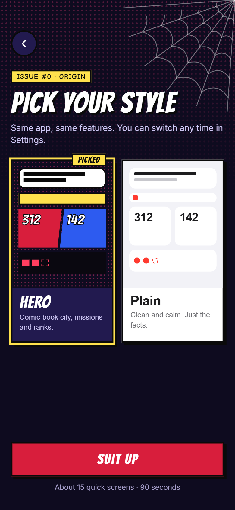
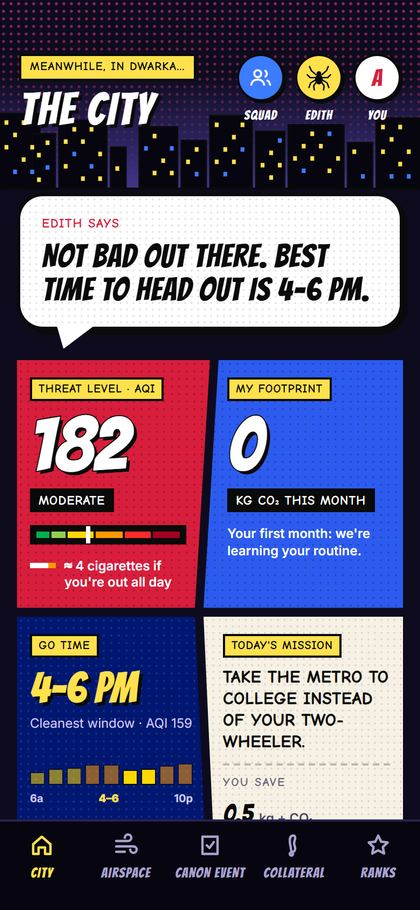
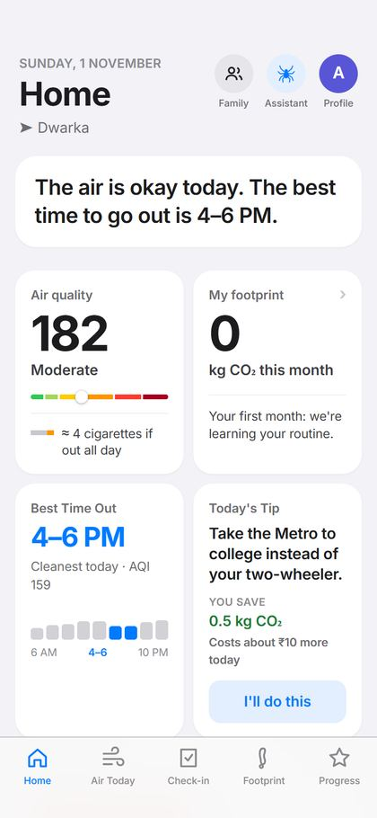
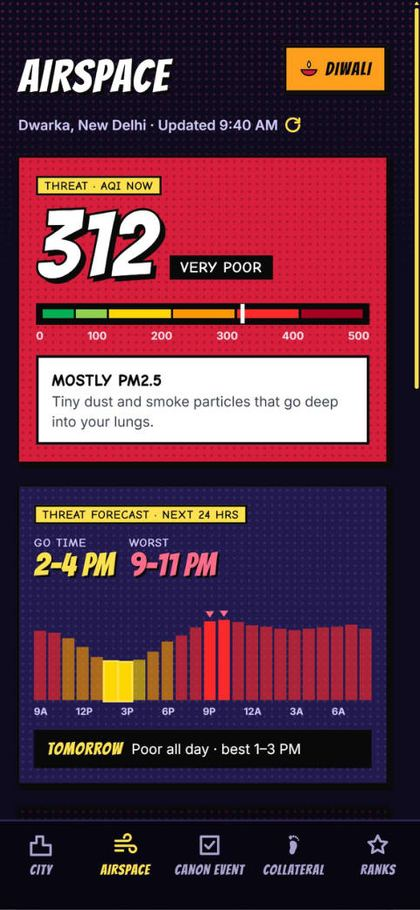
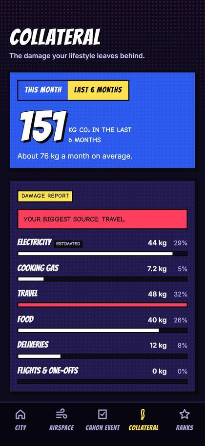
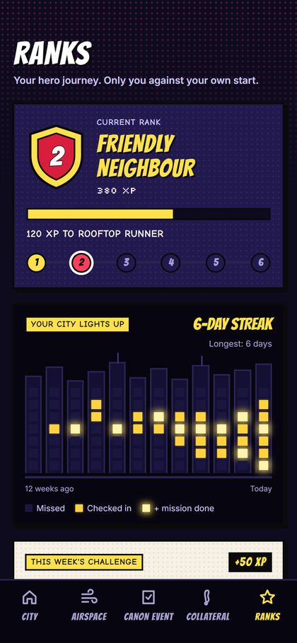
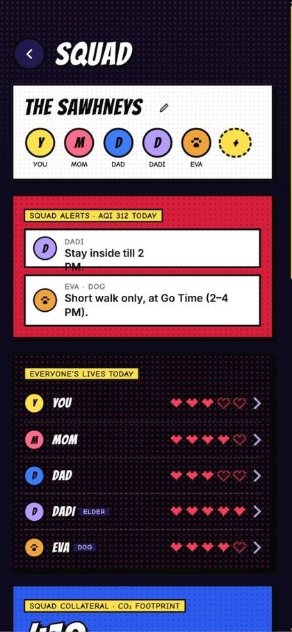
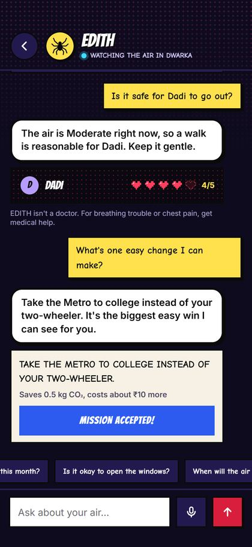

<p align="center">
  
</p>

<h3 align="center">Your friendly neighbourhood air defender.</h3>

<p align="center">
  <b>Environmental Defence &amp; Impact Tracking Hero</b><br>
  Live air quality and a personal carbon footprint in one app, built around Indian homes, routines and rupees.
</p>

<p align="center">
  <a href="https://edith-navy.vercel.app"><b>Try it live</b></a>
</p>

<p align="center">
  
  
  
  
</p>

## The problem

*Every city has a villain. Delhi's is invisible, and the apps we have only tell you its name.*

Air pollution takes about **8 years** off a Delhi resident's life, and nearly half of Delhi's pollution comes from local sources ([AQLI 2025, University of Chicago](https://aqli.epic.uchicago.edu/)).

Delhi checks the AQI every day. The number never says what to do next.

- **An AQI is a score, not a plan.** "340" doesn't tell you whether Dadi's morning walk is safe, or when the air clears enough to step out.
- **Carbon calculators weren't made for India.** Foreign units, foreign averages, and advice like "install rooftop solar" when you live in a rented flat.
- **A total changes nothing.** Knowing you emit 2 tonnes a year doesn't tell you which one habit to change first, or what you'd save.
- **Air apps and carbon apps never meet.** One shows what you breathe, the other what you emit, and nothing connects the two.

## What EDITH tracks

The air damages your health. Your lifestyle damages the air. EDITH tracks both and shows you the first change worth making.

| Damage taken | Damage dealt |
| --- | --- |
| Live AQI on India's own CPCB scale | Your carbon footprint, from a 30-second daily check-in |
| Today's damage to your lungs, as cigarettes' worth of smoke | Kept accurate by your monthly electricity bill |
| A safe window for your walk, so it does your lungs good instead of harm | The biggest part of your footprint, named: your commute, your AC or your food |
| Alerts for parents, children and pets | Cuts that fit your life, in kg CO2 and rupees |

## Features

**One sentence before any chart.** Most air apps open with a wall of numbers, graphs and tables. EDITH opens by telling you what to do today, in one line, and keeps the detail a tap away for when you want it.

**Comic book or calm: you choose.** Fight smog as a superhero in a comic-book city, or keep it clean and minimal. Switch any time.

<table>
  <tr>
    <td align="center" width="33%"><br><sub>Pick your style</sub></td>
    <td align="center" width="33%"><br><sub>Hero</sub></td>
    <td align="center" width="33%"><br><sub>Plain</sub></td>
  </tr>
</table>

<table>
  <tr>
    <td align="center" valign="top" width="33%"><b>Know when to step out</b></td>
    <td align="center" valign="top" width="33%"><b>A 30-second check-in</b></td>
    <td align="center" valign="top" width="33%"><b>See what really drives your footprint</b></td>
  </tr>
  <tr>
    <td align="center"></td>
    <td align="center"></td>
    <td align="center"></td>
  </tr>
  <tr>
    <td align="center" valign="top"><b>A reason to come back tomorrow</b></td>
    <td align="center" valign="top"><b>Looks out for everyone at home</b></td>
    <td align="center" valign="top"><b>Ask it anything about your air</b></td>
  </tr>
  <tr>
    <td align="center"></td>
    <td align="center"></td>
    <td align="center"></td>
  </tr>
</table>

<sub>Screens from the working app. Footprint, Ranks and Family show demo data.</sub>

**Built for India, not adapted for it.** CPCB's AQI scale, India's own grid emission factor, Delhi Metro fares, LPG cylinders, autos and two-wheelers, dal and paneer. EDITH never suggests something that doesn't fit your life, so every tip is one you could actually follow tomorrow.

## How the numbers work

**Footprint = what you did × its emission factor.** Air quality uses CPCB's method on [Open-Meteo](https://open-meteo.com/en/docs/air-quality-api) data.

| | | |
| --- | --- | --- |
| Electricity | 0.727 kg CO2 per unit | CEA Baseline Database v20.0 |
| AQI | CPCB National AQI bands | [CPCB, via IES](https://ies.gov.in/arthapedia/concept/national-air-quality-index) |
| Cigarettes | 22 µg/m³ PM2.5 for a day ≈ 1 cigarette | Berkeley Earth |
| Food | About 0.6 kg a day vegetarian, 1 kg non-veg | Pathak et al. 2010 |
| Domestic flights | 0.121 kg CO2 per passenger-km | [India GHG Program](https://indiaghgp.org/sites/default/files/AIR%20Transport%20Emission.pdf) |
| Bus and car in Delhi | 29 g per passenger-km, 144 g per car-km | [TERI](https://teriin.org/sites/default/transport/Per_passenger_emission_in_Delhi_Different_Modes.pdf) |
| Parcel delivery | 285 g CO2 per delivery in India | [Stand.earth](https://stand.earth/wp-content/uploads/2022/07/SRG_Last_Mile-FINAL.pdf) |

These are estimates to help you plan, not measurements or medical advice. Some factors, such as the Metro, international flights and big purchases, are our own working estimates. All of them are labelled in [`lib/factors.ts`](lib/factors.ts).

## Next up

EDITH's next steps focus on two things: replacing estimates with real measurements, and making the daily habit take even less effort.

- **Indoor air sensor.** A home-built ESP32 with a PM2.5 sensor costs about ₹1,000–1,500 and shows real indoor air and how much your purifier helps. Popular purifier brands have no official APIs, so a sensor of your own is more reliable than integrating with them.
- **Smart plugs for the AC.** Plugs with energy monitoring give real kWh for the biggest appliance, which replaces the AC-hours estimate.
- **Voice check-in.** Say "veg all day, Metro both ways, one Swiggy order" and EDITH fills in the steps.
- **Daily reminder.** A phone notification when your air turns bad or check-in is due, through the installable app.
- **Home-screen widget.** Today's AQI and Go Time without opening the app. This needs a native app.

## Tech stack

<p>
  
  
  
  
  
  
  
  
</p>

## Get started

**Try it now:** [edith-navy.vercel.app](https://edith-navy.vercel.app). Choose **Try without an account** and you're in, with no sign-up.

**Run it yourself** (Node.js 20 or newer):

```bash
git clone https://github.com/ashima19arora/edith.git
cd edith
npm install
npm run dev
```

Then open http://localhost:3000. Guest mode needs no keys. For Google sign-in and Family, copy `.env.example` to `.env.local`, add your Supabase keys, and run the files in [`supabase/migrations`](supabase/migrations) in the Supabase SQL editor, in order.

<br>

<p align="center">
  <i>With great air comes great responsibility.</i><br>
  Built with ❤️ for India
</p>
